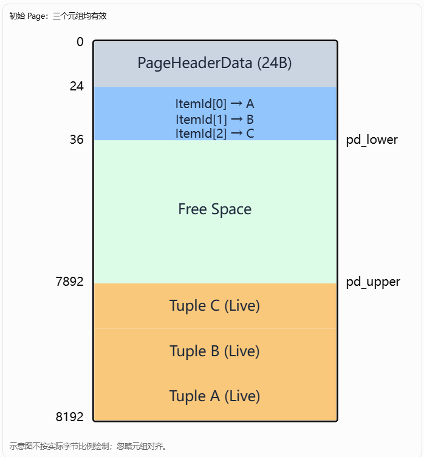
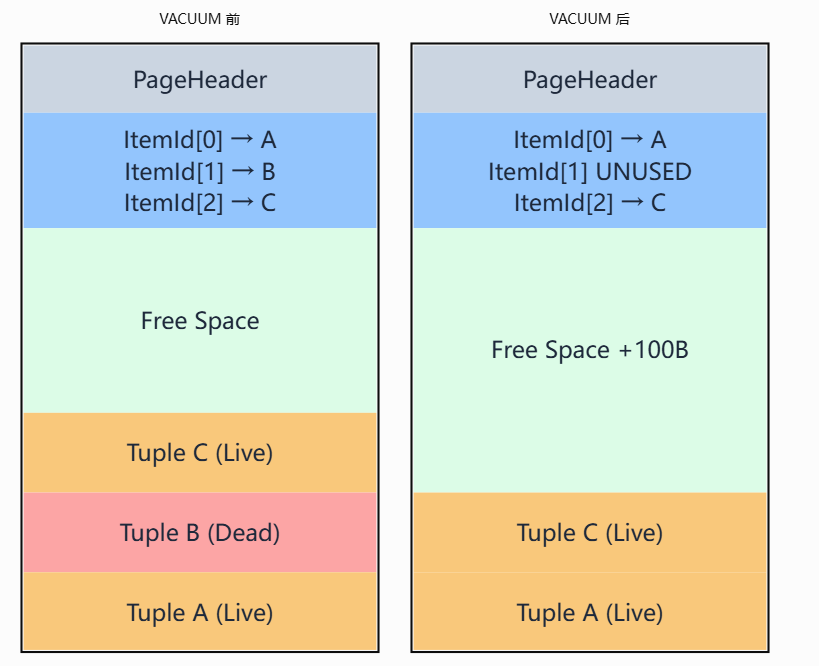

# PostgreSQL VACUUM 是如何回收表空间的？

在 PostgreSQL 中，`VACUUM` 的主要作用是回收死亡元组（Dead Tuple）占用的存储空间，使这些空间能够被后续的 INSERT、UPDATE 等操作重新利用。

但是，这里有一个非常重要的区别：

普通 VACUUM 通常不会缩小表文件，而 VACUUM FULL 可以缩小表文件并将磁盘空间归还给操作系统。

要理解其中的原理，需要从 PostgreSQL 的 MVCC、Heap Page 存储结构以及 VACUUM 的执行流程三个方面分析。

## 一、为什么 PostgreSQL 需要 VACUUM？

PostgreSQL 使用 MVCC（多版本并发控制）实现事务隔离。

在 MVCC 机制下，执行 `UPDATE` 或 `DELETE` 时，PostgreSQL 通常不会立即删除原来的元组。

例如，创建一张表：

```
CREATE TABLE test (
    id INT,
    name TEXT
);

INSERT INTO test VALUES (1, 'Alice');
```

假设执行：

```
UPDATE test SET name = 'Bob' WHERE id = 1;
```

从逻辑上看，数据由 Alice 变成了 Bob。

但从物理存储上看，通常会发生：

```
Heap Page
+-----------------------------------+
|                                   |
| Tuple V1                          |
| id = 1, name = Alice              |
| xmax = 更新事务 XID               |
|                                   |
| Tuple V2                          |
| id = 1, name = Bob                |
| xmin = 更新事务 XID               |
|                                   |
+-----------------------------------+
```

旧版本 V1 不会在更新时立即被删除，而是继续存在于 Heap Page 中。

当更新事务提交，并且系统确认没有任何事务还需要访问 V1 时，V1 就可以被回收。

如果不断执行 UPDATE：

```
UPDATE test SET name = 'Tom' WHERE id = 1;
UPDATE test SET name = 'Jack' WHERE id = 1;
UPDATE test SET name = 'David' WHERE id = 1;
```

那么在没有及时清理的情况下，Heap 中可能存在：

```
V1 (Alice)  -- Dead
V2 (Bob)    -- Dead
V3 (Tom)    -- Dead
V4 (Jack)   -- Dead
V5 (David)  -- Live
```

其中 V1～V4 都可能成为可以回收的死亡元组。

如果没有 VACUUM，这些旧版本就可能长期占用存储空间，导致表膨胀（Table Bloat）。

需要注意，PostgreSQL 也有 HOT 更新、页面剪枝（Page Pruning）等机制，可以在普通访问过程中提前回收部分旧版本的空间，因此并不是所有旧版本都必须等待 VACUUM 才能被清理。

## 二、普通 VACUUM 如何回收空间？

先看 PostgreSQL Heap Page 的结构。

### 1. Heap Page 的物理结构

PostgreSQL 默认的 Page 大小为 8KB。

一个 Heap Page 大致如下：

```
+------------------------------------+ 低地址
| PageHeaderData                     |
| pd_lower / pd_upper / pd_special   |
+------------------------------------+
| ItemIdData[0]                      |
| ItemIdData[1]                      |
| ItemIdData[2]                      |
| ...                                |
+------------------------------------+
|                                    |
| Free Space                         |
|                                    |
+------------------------------------+
| Tuple V3                           |
+------------------------------------+
| Tuple V2                           |
+------------------------------------+
| Tuple V1                           |
+------------------------------------+ 高地址
```

其中：

- `PageHeaderData`：记录页面元数据。
- `ItemIdData`：行指针（Line Pointer），记录元组的位置、长度和状态。
- `Free Space`：页面中尚未使用的连续空间。
- `Tuple`：真正存储的数据行。

需要注意，`ItemIdData` 和 Tuple 是分离的。

因此，PostgreSQL 可以移动页面内部的元组，而不必改变元组对应的行指针编号。

### 2. VACUUM 回收死亡元组

假设某个页面中存在三个元组：

```
Page 100
+--------------------------------+
| ItemId[0] -> Tuple A           |
| ItemId[1] -> Tuple B           |
| ItemId[2] -> Tuple C           |
+--------------------------------+
| Free Space                     |
+--------------------------------+
| Tuple C (Live)                 |
| Tuple B (Dead)                 |
| Tuple A (Live)                 |
+--------------------------------+
```

执行：

```
VACUUM test;
```

在确认 Tuple B 已经不再被任何事务需要后，VACUUM 可以回收它的存储空间。

清理后：

```
Page 100
+--------------------------------+
| ItemId[0] -> Tuple A           |
| ItemId[1] -> Unused            |
| ItemId[2] -> Tuple C           |
+--------------------------------+
|                                |
| Free Space（增加）              |
|                                |
+--------------------------------+
| Tuple C (Live)                 |
| Tuple A (Live)                 |
+--------------------------------+
```

实际执行过程中，VACUUM 还需要考虑索引引用、HOT 链以及行指针状态，因此死亡元组的行指针不一定能立即标记为 `LP_UNUSED`。

在满足安全条件后，页面整理会将存活元组压紧，把释放出来的空间合并为页面内部的连续空闲空间。

关键点：VACUUM 主要是在 Page 内部回收空间，而不是把整个 Page 从表文件中删除。

### 3. 回收后的空间如何重新利用？

PostgreSQL 使用 FSM（Free Space Map）记录 Heap Page 中可供插入的空闲空间。

例如：

```
VACUUM 前：

Page 100 -> 100 bytes free
Page 101 -> 200 bytes free
Page 102 -> 300 bytes free

VACUUM 后：

Page 100 -> 3000 bytes free
Page 101 -> 4000 bytes free
Page 102 -> 2500 bytes free
```

这些空闲空间信息会反映到 FSM 中。

当后续执行：

```
INSERT INTO test VALUES (2, 'New User');
```

PostgreSQL 可以通过 FSM 寻找有足够空闲空间的 Page，将新元组写入其中。

因此，VACUUM 回收的空间并没有消失，而是被重新利用。

从操作系统角度看，表文件大小可能没有变化：

```
VACUUM 前：100 MB
VACUUM 后：100 MB
```

但表内部可复用的空闲空间增加了。

这意味着，后续插入数据时，PostgreSQL 可能不需要继续扩大表文件。

## 三、普通 VACUUM 能不能真正缩小表文件？

可以，但有条件。

普通 VACUUM 存在一个特殊的空间回收机制：截断表文件末尾连续的空闲 Page（Heap Truncation）。

例如，假设一张表有 1000 个 Page：

```
表文件（1000 Pages）

Page 0      [Live]
Page 1      [Live]
Page 2      [Free]
Page 3      [Live]
...
Page 700    [Live]
Page 701    [Free]
Page 702    [Free]
...
Page 999    [Free]
```

假设 Page 701～999 都已经完全空闲，那么 VACUUM 可以尝试截断表文件：

```
截断前：1000 Pages

截断后：701 Pages
```

如果每个 Page 为 8KB：

```
回收空间 = 299 × 8192
         ≈ 2.34 MB
```

这部分空间可以真正归还给操作系统。

但是，如果表文件末尾还有存活元组：

```
Page 0      [Live]
Page 1      [Free]
Page 2      [Free]
...
Page 998    [Free]
Page 999    [Live]
```

普通 VACUUM 无法通过截断文件来回收中间的空闲 Page，因为 Page 999 仍然包含数据。

这也是为什么删除大量数据后，执行 VACUUM，表文件大小可能依然没有变化。

在 PostgreSQL 16 中，可以使用：

```
VACUUM (VERBOSE, TRUNCATE ON) test;
```

其中 `TRUNCATE ON` 允许尝试截断表末尾的空闲 Page，默认通常就是开启的。截断操作需要短暂获取 `ACCESS EXCLUSIVE` 锁，因此也不保证每次都能完成。

PostgreSQL+1


## 四、VACUUM FULL 为什么可以真正回收磁盘空间？

`VACUUM FULL` 与普通 VACUUM 的实现原理完全不同。

普通 VACUUM 是在原有表文件上清理死亡元组，而 `VACUUM FULL` 会重写整个表文件。

假设原来的表：

```
原始表文件：1000 Pages

+--------------------+
| Page 0   Live      |
| Page 1   Dead      |
| Page 2   Live      |
| Page 3   Dead      |
| Page 4   Live      |
| ...                |
| Page 999 Live      |
+--------------------+
```

执行：

```
VACUUM FULL test;
```

PostgreSQL 会创建新的物理存储文件，将有效元组重新写入：

```
原始表文件                 新表文件

Page 0  [Live]   ------>  Page 0 [Live]
Page 1  [Dead]             Page 1 [Live]
Page 2  [Live]   ------>  Page 2 [Live]
Page 3  [Dead]
Page 4  [Live]   ------> 
...
Page 999 [Live]  ------>

1000 Pages                  300 Pages（示意）
```

完成后，PostgreSQL 将表切换到新的存储文件，并在适当时机删除旧文件。

因此：

```
VACUUM FULL 前：约 8 MB
VACUUM FULL 后：约 2.4 MB
```

这只是示意，实际大小取决于元组大小、页面布局等因素。

`VACUUM FULL` 还需要重建相关索引，并且执行期间持有 `ACCESS EXCLUSIVE` 锁，会阻塞该表的普通查询和修改。因此不适合频繁执行。

PostgreSQL+1


## 五、从 PostgreSQL 内核源码理解 VACUUM

以 PostgreSQL 16 为例，普通 VACUUM 的核心实现主要位于：

```
src/backend/commands/vacuum.c
src/backend/access/heap/vacuumlazy.c
src/backend/access/heap/pruneheap.c
src/backend/storage/freespace/freespace.c
```

其中 `vacuumlazy.c` 是理解普通 VACUUM 的重点。

可以将其主要工作流程概括为：

```
VACUUM test
    |
    v
ExecVacuum()
    |
    v
vacuum()
    |
    v
vacuum_rel()
    |
    v
table_relation_vacuum()
    |
    v
heap_vacuum_rel()
    |
    v
lazy_scan_heap()
    |
    +-- 扫描 Heap Page
    |
    +-- 判断元组是否可以回收
    |
    +-- 页面剪枝，收集需要清理索引的死亡 TID
    |
    v
lazy_vacuum_all_indexes()
    |
    +-- 清理索引中指向死亡元组的条目
    |
    v
lazy_vacuum_heap_rel()
    |
    +-- 回收 Heap 中可安全释放的行指针和空间
    |
    v
lazy_truncate_heap()
    |
    +-- 尝试截断表末尾的空闲 Page
    |
    v
更新 FSM / 统计信息
```

这是简化的逻辑流程。实际实现可能分批扫描和清理，索引清理也可能因条件不同而跳过。

其中有三个关键问题值得关注。

### 1. 如何判断元组是否可以回收？

VACUUM 并不是看到 `xmax` 非零就立即删除元组。

它需要考虑事务提交状态，以及是否还有其他事务可能访问该元组。

相关判断涉及：

```
HeapTupleSatisfiesVacuum(...)
```

在 PostgreSQL 16 中，VACUUM 的可删除性判断也涉及：

```
HeapTupleSatisfiesVacuumHorizon(...)
```

如果某个元组仍然可能被其他事务访问，就不能立即清理。

### 2. 为什么需要清理索引？

假设 B-Tree 索引中存在：

```
Index Entry
    |
    v
TID = (100, 5)
    |
    v
Heap Page 100, Offset 5
```

如果对应的 Heap Tuple 已经死亡，索引中可能仍然保留着指向它的条目。

VACUUM 需要在适当阶段清理这些索引条目，然后才能安全地将对应的 Heap 行指针释放为可复用状态。

否则，如果直接复用行指针，旧索引条目就可能错误地指向新元组。

### 3. VACUUM 如何整理 Page 内部的空闲空间？

页面整理相关代码可以重点关注：

```
PageRepairFragmentation(...)
```

其核心思想是：

- 找出页面中仍然需要保留的元组。
- 重新排列这些元组在 Page 内部的物理位置。
- 更新相应 `ItemIdData` 的偏移。
- 将零散空间合并为连续的 Free Space。

这里需要区分两个概念：

Page 内部的元组物理偏移可以改变，但其行指针编号通常保持不变。

因此，对外使用的 TID（Block Number + Offset Number）不需要因为页面内部压缩而改变。

## 六、如何通过 SQL 观察 VACUUM 的效果？

可以在 PostgreSQL 16 中执行以下实验。

```
-- 1. 创建测试表
CREATE TABLE vacuum_test (
    id INT,
    data TEXT
);

-- 2. 插入数据
INSERT INTO vacuum_test
SELECT i, repeat('a', 100)
FROM generate_series(1, 100000) i;

-- 3. 查看表文件大小
SELECT pg_size_pretty(
    pg_relation_size('vacuum_test')
);

-- 4. 删除大量数据
DELETE FROM vacuum_test
WHERE id <= 80000;

-- 5. 执行普通 VACUUM
VACUUM (VERBOSE, TRUNCATE OFF) vacuum_test;

-- 6. 再次查看文件大小
SELECT pg_size_pretty(
    pg_relation_size('vacuum_test')
);

-- 7. 执行 VACUUM FULL
VACUUM FULL vacuum_test;

-- 8. 再次查看文件大小
SELECT pg_size_pretty(
    pg_relation_size('vacuum_test')
);
```

这里特意使用 `TRUNCATE OFF`，是为了避免普通 VACUUM 截断末尾空闲 Page，从而更容易观察其内部空间复用的特征。

预期现象是：

| 操作         | 表文件大小 | 空间变化         |
| ------------ | ---------- | ---------------- |
| 插入 10 万行 | 增大       | 分配 Heap Page   |
| 删除 8 万行  | 通常不变   | 产生死亡元组     |
| 普通 VACUUM  | 通常不变   | 回收可复用空间   |
| VACUUM FULL  | 明显缩小   | 重写并压缩表文件 |

具体大小与执行环境有关。

## 七、总结

| 对比项               | VACUUM                 | VACUUM FULL            |
| -------------------- | ---------------------- | ---------------------- |
| 清理死亡元组         | 是                     | 是                     |
| 回收 Page 内部空间   | 是                     | 是                     |
| 复用原有 Heap Page   | 是                     | 重新生成表文件         |
| 缩小表文件           | 仅在满足末尾截断条件时 | 通常可以               |
| 归还操作系统磁盘空间 | 有条件                 | 是                     |
| 是否重写整张表       | 否                     | 是                     |
| 是否阻塞普通 SELECT  | 通常不会               | 会                     |
| 适用场景             | 日常维护               | 严重表膨胀后的空间整理 |

最后要特别强调：

PostgreSQL 中的空间回收有三个层次：

1. Tuple 级别：清理死亡元组，使元组占用的字节重新可用。
2. Page 级别：整理页面内部空间，通过 FSM 支持后续插入复用。
3. Relation 文件级别：通过末尾截断或者重写表文件，将磁盘空间归还操作系统。

普通 VACUUM 主要解决前两个层次的问题，`VACUUM FULL` 则可以进一步解决整个表文件的膨胀问题。

如果接下来准备从 PostgreSQL 16 源码深入研究，我建议重点看 `vacuumlazy.c` 中的 `lazy_scan_heap()`、`lazy_vacuum_heap_rel()` 和 `lazy_truncate_heap()`，尤其是死亡元组何时真正变成可复用空间，以及为什么索引清理必须与 Heap 空间回收协调进行。这两个问题是理解 VACUUM 内核实现的关键。

# 结合 Page 内部格式解释普通Vacuum 之后的Page 内部空间的变化

# PostgreSQL 普通 VACUUM 如何回收 Page 内部空间？

要理解普通 `VACUUM` 如何回收空间，最关键的是理解 PostgreSQL 的 Heap Page 内部结构，以及 `pd_lower`、`pd_upper`、`ItemIdData` 和 HeapTuple 之间的关系。

普通 VACUUM 并不是简单地把死亡元组从 Page 中删除，而是通过修改行指针状态、清理死亡元组、压缩页面内部的数据区域，使原来被死亡元组占用的空间重新变成可用空间。

下面以 PostgreSQL 16 为例，从 Page 的物理结构开始分析。

## 一、Heap Page 的内部结构

PostgreSQL 默认使用 8KB 的 Page。

在源码 `src/include/storage/bufpage.h` 中，Page 的基本布局如下：

```
低地址
0
+----------------------------------+
| PageHeaderData                   |
|                                  |
| pd_lower                         |
| pd_upper                         |
| pd_special                       |
+----------------------------------+
| ItemIdData[0]                    |
| ItemIdData[1]                    |
| ItemIdData[2]                    |
| ...                              |
+----------------------------------+ <-- pd_lower
|                                  |
|       Free Space                 |
|                                  |
+----------------------------------+ <-- pd_upper
|                                  |
| HeapTuple C                      |
| HeapTuple B                      |
| HeapTuple A                      |
|                                  |
+----------------------------------+ <-- pd_special
8192
高地址
```

整个 Page 分为四个区域。

| 区域             | 作用                           | 增长方向         |
| ---------------- | ------------------------------ | ---------------- |
| PageHeaderData   | 页面头部元数据                 | 固定位置         |
| ItemIdData 数组  | 保存元组的位置和状态           | 从低地址向高地址 |
| Free Space       | 可用于插入新元组的连续空闲空间 | 随数据变化       |
| HeapTuple 数据区 | 存储真正的元组                 | 从高地址向低地址 |

其中，`pd_lower` 和 `pd_upper` 是两个非常重要的边界。

```
typedef struct PageHeaderData
{
    /* 省略部分字段 */

    LocationIndex pd_lower;
    LocationIndex pd_upper;
    LocationIndex pd_special;

    /* 省略其他字段 */
} PageHeaderData;
```

它们的含义是：

- `pd_lower`：ItemIdData 数组结束的位置。
- `pd_upper`：HeapTuple 数据区域开始的位置。
- `pd_special`：特殊空间开始的位置，普通 Heap Page 通常为 8192。

因此，Page 中连续空闲空间的大小为：

```
free_space = pd_upper - pd_lower;
```

注意，这个公式计算的是 Page 内部的连续空闲区域，不包括尚未经过整理的碎片空间，也不扣除插入新元组可能需要的行指针开销。

## 二、假设一个 Page 中存在三个元组

为了方便理解，我们假设一个 Page 中存在三个元组：

```
Tuple A：100 bytes
Tuple B：100 bytes
Tuple C：100 bytes
```

忽略对齐开销，假设每个元组实际占用 100 字节。

PageHeaderData 占用 24 字节，每个 ItemIdData 占用 4 字节。

插入三个元组后，Page 的布局如下：



对应的数值为：

```
pd_lower = 24 + 3 × 4 = 36

pd_upper = 8192 - 3 × 100 = 7892

Free Space = 7892 - 36 = 7856 bytes
```

每个 `ItemIdData` 保存元组在 Page 中的偏移量和长度等信息。

例如：

```c
typedef struct ItemIdData
{
    unsigned lp_off:15;
    unsigned lp_flags:2;
    unsigned lp_len:15;
} ItemIdData;
```

三个行指针可以表示为：

```
ItemId[0] -> offset 8092, length 100, LP_NORMAL
ItemId[1] -> offset 7992, length 100, LP_NORMAL
ItemId[2] -> offset 7892, length 100, LP_NORMAL
```

需要注意，元组的 TID 是：

```
(BlockNumber, OffsetNumber)
```

这里的 `OffsetNumber` 是行指针编号（从 1 开始），而不是 `lp_off` 中保存的字节偏移。

## 三、删除 Tuple B 后，Page 发生什么变化？

现在执行：

```
DELETE FROM test WHERE id = 2;
```

假设 Tuple B 对应 `id = 2`。

PostgreSQL 不会立即释放 Tuple B 的物理空间，而是修改 Tuple B 的事务可见性信息。

例如：

```
Tuple B:

xmin = 100
xmax = 200
```

其中事务 200 执行了 DELETE。

在该事务提交后，如果没有任何事务还需要访问 Tuple B，它就可以被回收。

但是，在 DELETE 刚完成时，Page 通常仍然是：

```
+----------------------------------+
| PageHeaderData                   |
+----------------------------------+
| ItemId[0] -> Tuple A             |
| ItemId[1] -> Tuple B             |
| ItemId[2] -> Tuple C             |
+----------------------------------+ <-- pd_lower
|                                  |
| Free Space                       |
|                                  |
+----------------------------------+ <-- pd_upper
| Tuple C (Live)                   |
+----------------------------------+
| Tuple B (Dead)                   |
+----------------------------------+
| Tuple A (Live)                   |
+----------------------------------+
```

此时：

```
pd_lower = 36
pd_upper = 7892

Free Space = 7856 bytes
```

DELETE 并没有直接改变 `pd_lower` 和 `pd_upper`。

Tuple B 仍然占用 100 字节，`ItemId[1]` 仍然指向它。

## 四、VACUUM 清理 Tuple B 后发生什么变化？

现在执行：

```
VACUUM test;
```

假设 Tuple B 已经满足回收条件，且相关索引条目已经安全清理。

VACUUM 可以将：

```
ItemId[1] -> Tuple B
```

修改为：

```
ItemId[1] -> LP_UNUSED
```

然后通过页面整理将 Tuple B 的物理空间释放出来。

这里最关键的是：

PostgreSQL 不需要移动整个 Page，也不需要改变 Tuple A、Tuple C 的行指针编号，只需要重新排列 Page 内部的元组数据。

### 1. 页面压缩前后对比



注意右图：

1. `ItemId[1]` 仍然占用 4 字节，只是状态变为 `LP_UNUSED`。
2. Tuple B 原来占用的 100 字节已经被回收。
3. Tuple C 在 Page 内部发生了移动。
4. `pd_upper` 增大了 100 字节。
5. `pd_lower` 没有变化。

因此：

```
VACUUM 前：

pd_lower = 36
pd_upper = 7892

Free Space = 7856


VACUUM 后：

pd_lower = 36
pd_upper = 7992

Free Space = 7956
```

可以看到：

```
Free Space 增加了 100 bytes
```

这就是普通 VACUUM 在 Page 内部回收空间的核心原理。

这里的 100 字节是简化示例，实际页面压缩还需要考虑 `MAXALIGN` 对齐。

### 2. Tuple C 移动了，为什么索引不受影响？

这是 PostgreSQL Page 设计中非常重要的一点。

假设 Tuple C 原来的 TID 为：

```
(100, 3)
```

其中：

- `100`：BlockNumber。
- `3`：OffsetNumber，对应第三个行指针。

VACUUM 前：

```
ItemId[2]
    |
    v
lp_off = 7892
    |
    v
Tuple C
```

VACUUM 后：

```
ItemId[2]
    |
    v
lp_off = 7992
    |
    v
Tuple C
```

虽然 Tuple C 在 Page 中的物理字节偏移发生了变化，但它对应的行指针编号仍然是 3。

因此：

```
TID = (100, 3)
```

保持不变。

索引中保存的是 TID，而不是 Tuple C 在 Page 内的字节偏移。

这使得 PostgreSQL 可以安全地在 Page 内部移动元组，而不必因为这种移动去更新索引。

## 五、为什么 ItemId[1] 不直接删除？

前面的示例中，VACUUM 后：

```
ItemId[0] -> Tuple A
ItemId[1] -> LP_UNUSED
ItemId[2] -> Tuple C
```

你可能会问：

既然 Tuple B 已经删除，为什么不直接把 `ItemId[1]` 也删除？

原因是：OffsetNumber 是 TID 的一部分。

假设原来的 TID 为：

```
Tuple A -> (100, 1)
Tuple B -> (100, 2)
Tuple C -> (100, 3)
```

如果直接删除中间的 `ItemId[1]`，并将后面的 ItemId 前移：

```
ItemId[0] -> Tuple A
ItemId[1] -> Tuple C
```

那么 Tuple C 的 TID 就从：

```
(100, 3)
```

变成了：

```
(100, 2)
```

这会导致索引中保存的 TID 失效。

因此，PostgreSQL 通常保留中间的行指针位置，并将其标记为 `LP_UNUSED`，以便后续插入时复用。

例如：

```
INSERT INTO test VALUES (4, 'David');
```

如果新元组插入这个 Page，并且可以复用空闲行指针：

```
ItemId[0] -> Tuple A
ItemId[1] -> Tuple D
ItemId[2] -> Tuple C
```

新元组 D 就可以获得：

```
TID = (100, 2)
```

这里还需要注意一个细节：如果 `LP_UNUSED` 出现在行指针数组末尾，PostgreSQL 可以在安全情况下缩短行指针数组，使 `pd_lower` 减小。但对于中间的空闲行指针，一般不会直接移动后续行指针。

另外，HOT 更新可能保留 `LP_REDIRECT` 行指针，不能把所有死亡元组对应的行指针都简单理解为立即变成 `LP_UNUSED`。

## 六、结合 PostgreSQL 16 源码理解 Page 空间整理

PostgreSQL 中，页面压缩相关的核心函数是：

```
PageRepairFragmentation(Page page);
```

源码位置：

```
src/backend/storage/page/bufpage.c
```

这个函数负责整理 Page 内部的元组数据区域。

可以将其逻辑简化为：

```
void
PageRepairFragmentation(Page page)
{
    /*
     * 1. 遍历 ItemIdData 数组
     *
     * 2. 找出仍然占用存储空间的元组
     *
     * 3. 计算这些元组的新位置
     *
     * 4. 移动元组数据
     *
     * 5. 更新 ItemIdData.lp_off
     *
     * 6. 更新 PageHeaderData.pd_upper
     */
}
```

这只是逻辑示意，不是 PostgreSQL 的实际函数实现。

其核心效果是：

```
原始 Page：

+-------------------+
| ItemIdData        |
+-------------------+
| Free Space        |
+-------------------+
| Tuple C           |
+-------------------+
| Dead Tuple B      |
+-------------------+
| Tuple A           |
+-------------------+


整理后：

+-------------------+
| ItemIdData        |
+-------------------+
|                   |
| Larger Free Space |
|                   |
+-------------------+
| Tuple C           |
+-------------------+
| Tuple A           |
+-------------------+
```

`PageRepairFragmentation()` 并不负责判断哪些元组已经死亡，也不负责清理索引。

它主要负责根据当前行指针状态，整理页面内部仍然需要保留的元组存储空间。

死亡元组的可删除性判断、索引清理和行指针状态修改，是 VACUUM 其他阶段需要完成的工作。

## 七、VACUUM 回收的空间如何被后续 INSERT 使用？

VACUUM 完成后，页面空闲空间信息可以记录到 FSM（Free Space Map）中。

假设 Page 100：

```
VACUUM 前：

pd_upper - pd_lower = 7856 bytes

VACUUM 后：

pd_upper - pd_lower = 7956 bytes
```

FSM 可以记录 Page 100 具有更多可用空间。

后续执行：

```
INSERT INTO test VALUES (5, 'New');
```

PostgreSQL 可以通过 FSM 寻找能够容纳新元组的 Page。

找到 Page 100 后，再通过类似下面的页面操作插入元组：

```
PageAddItemExtended(...)
```

如果页面中存在可复用的 `LP_UNUSED` 行指针，则可能直接复用它，不必增加新的 ItemIdData。

因此，普通 VACUUM 之后的空间复用分为两个部分：

- HeapTuple 存储空间复用：通过页面压缩增大 `pd_upper - pd_lower`。
- ItemIdData 行指针复用：将安全释放的行指针标记为 `LP_UNUSED`，供后续插入使用。

## 八、总结

普通 VACUUM 对 Heap Page 的影响，可以概括为：

| Page 内部字段 | VACUUM 前     | VACUUM 后   |
| ------------- | ------------- | ----------- |
| `pd_lower`    | 36            | 36          |
| `pd_upper`    | 7892          | 7992        |
| `pd_special`  | 8192          | 8192        |
| `ItemId[0]`   | LP_NORMAL     | LP_NORMAL   |
| `ItemId[1]`   | LP_NORMAL     | LP_UNUSED   |
| `ItemId[2]`   | LP_NORMAL     | LP_NORMAL   |
| Tuple B       | 占用 100 字节 | 空间被回收  |
| Tuple C       | offset 7892   | offset 7992 |
| Free Space    | 7856 字节     | 7956 字节   |

以上是一个没有 HOT 重定向、死亡元组已安全清理、且忽略对齐开销的简化示例。

最关键的三个结论：

1. VACUUM 回收空间的核心，是让死亡元组占用的字节重新进入 Page 的 Free Space，而不是删除整个 Page。
2. 页面整理过程中，`pd_upper` 通常向高地址移动，`pd_lower` 通常不变，空闲空间因此增加。
3. 存活元组可以在 Page 内部移动，但行指针编号不变，因此 TID 不变，不需要修改对应的索引条目。

Vacuum 最核心机制：普通 Vacuum 在回收可清理的死元组的时候，如果死元组对应的行指针在中间的话，是不会回收死元组的行指针空间的。但是死元组对应的数据空间会被回收，并且其他存活的元组的数据部分在Page内的位置可能因此发生变动，从而需要修改这些变动的活元组行指针的偏移量lp_off。使用这种机制，就可以释放 Page 内死元组占用空间，扩大Page 的空闲空间。

如果你正在阅读 PostgreSQL 16 源码，建议下一步重点研究 `PageRepairFragmentation()`。它能直接解释 `pd_upper` 如何变化、元组如何通过 `memmove()` 重新排列，以及为什么压缩后 TID 仍然保持稳定。