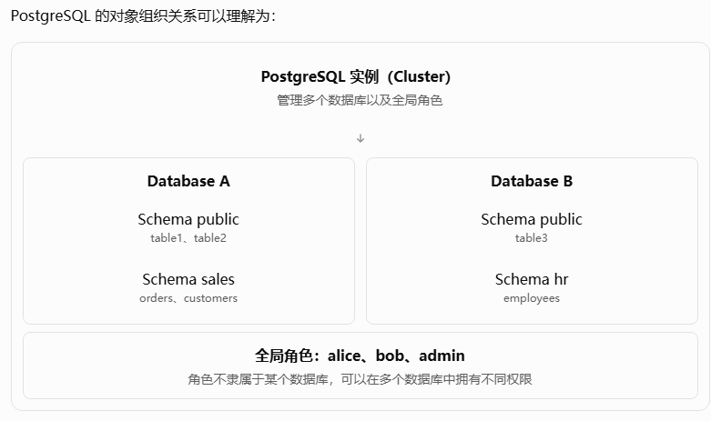
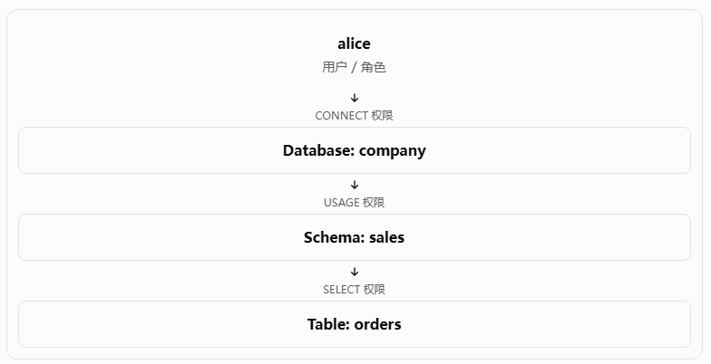

# 一文讲解 PostgreSQL 中数据库、用户、Schema、表之间的权限关系

在 PostgreSQL 中，数据库（Database）、用户（User）、模式（Schema）、表（Table）是几个非常重要的概念。

要理解它们之间的权限关系，首先需要明确：

数据库、Schema、表属于对象组织结构；用户和角色属于权限管理体系。

## 一、PostgreSQL 的对象组织结构

PostgreSQL 的对象组织关系可以理解为：



这里需要理解四个概念。

**1. Database（数据库）**

一个 PostgreSQL 实例可以包含多个数据库。数据库之间通常是相互隔离的，一个连接只能直接访问当前连接的数据库。

**2. Schema（模式）**

Schema 是数据库内部的命名空间，用来组织表、视图、函数等对象。

例如：

```
CREATE SCHEMA sales;

CREATE TABLE sales.orders (
    id INT,
    amount INT
);
```

这里 `sales` 是 Schema，`orders` 是表。

**3. Table（表）**

表是真正存储业务数据的数据库对象，每张普通表都属于某个 Schema。

**4. User / Role（用户和角色）**

PostgreSQL 使用 Role 统一管理用户和角色。

```
CREATE ROLE developer LOGIN PASSWORD '123456';
```

也可以写成：

```
CREATE USER developer PASSWORD '123456';
```

`CREATE USER` 本质上相当于创建一个具有 `LOGIN` 属性的角色。

特别注意：用户并不属于某个数据库，而是整个 PostgreSQL 实例共享的。

## 二、PostgreSQL 的权限体系

PostgreSQL 的权限管理可以分为几个层次：

| 对象层次 | 常见权限              | 作用                         |
| -------- | --------------------- | ---------------------------- |
| Database | CONNECT               | 允许连接数据库               |
| Database | CREATE                | 允许在数据库中创建 Schema 等 |
| Database | TEMPORARY             | 允许创建临时表               |
| Schema   | USAGE                 | 允许访问 Schema 中的对象名称 |
| Schema   | CREATE                | 允许在 Schema 中创建对象     |
| Table    | SELECT                | 查询表数据                   |
| Table    | INSERT                | 插入数据                     |
| Table    | UPDATE                | 更新数据                     |
| Table    | DELETE                | 删除数据                     |
| Sequence | USAGE、SELECT、UPDATE | 使用、读取或修改序列         |

这里有一个非常重要的原则：

拥有上层对象的权限，并不意味着自动拥有下层对象的权限。

例如，用户拥有数据库的 `CONNECT` 权限，不代表拥有数据库中所有表的 `SELECT` 权限。

同样，用户拥有 Schema 的 `USAGE` 权限，也不代表能够查询其中所有表。

## 三、用户访问一张表，需要哪些权限？

假设数据库中存在以下对象：

```
Database: company
    |
    +-- Schema: sales
           |
           +-- Table: orders
```

用户 `alice` 希望执行：

```
SELECT * FROM sales.orders;
```

在没有超级用户权限、所有者特权等特殊情况时，需要满足三个条件：



对应 SQL：

```
-- 允许连接数据库
GRANT CONNECT ON DATABASE company TO alice;

-- 允许访问 Schema
GRANT USAGE ON SCHEMA sales TO alice;

-- 允许查询表
GRANT SELECT ON TABLE sales.orders TO alice;
```

需要注意，这些授权通常由对象所有者、具有相应授权选项的角色或超级用户执行。

另外，PostgreSQL 默认会向 `PUBLIC` 授予一些权限，例如数据库的 `CONNECT`，因此实际环境中不一定需要显式执行全部三条授权语句。

## 四、对象所有者（Owner）与普通用户有什么区别？

PostgreSQL 每个数据库、Schema、表等对象都有一个 Owner。

例如：

```
CREATE USER alice PASSWORD '123456';

CREATE TABLE public.test (
    id INT
);
```

假设创建表的当前用户是 `postgres`，那么 `test` 表的 Owner 通常就是 `postgres`。

Owner 与普通授权用户有本质区别：

- Owner 通常拥有对象的完整操作权限。
- Owner 可以删除、修改自己拥有的对象。
- Owner 可以向其他用户授予对象权限。
- 普通用户即使拥有 `SELECT、INSERT、UPDATE、DELETE`，也不能因此直接删除表。

例如：

```
GRANT ALL PRIVILEGES
ON TABLE public.test TO alice;
```

这里的 `ALL PRIVILEGES` 只是授予该表支持的全部可授予权限，并不意味着 `alice` 成为了 Owner。

因此，下面的操作仍可能被拒绝：

```
DROP TABLE public.test;
```

因为 `DROP TABLE` 并不是一个可以通过普通 `GRANT` 授予的表权限。

可以通过下面的 SQL 转移表所有权：

```
ALTER TABLE public.test OWNER TO alice;
```

执行该语句需要满足 PostgreSQL 对所有权变更的要求。

## 五、Role 与 User 的关系

PostgreSQL 中，Role 不仅可以表示登录用户，还可以用来表示一组权限。

例如，有三个用户：

```
CREATE USER alice PASSWORD '123456';
CREATE USER bob PASSWORD '123456';
CREATE USER charlie PASSWORD '123456';
```

希望 `alice` 和 `bob` 都能够查询 `sales.orders`。

可以直接授权：

```
GRANT SELECT ON sales.orders TO alice;
GRANT SELECT ON sales.orders TO bob;
```

但用户多了之后，这种方式管理起来非常麻烦。

更好的方式是创建一个权限角色：

```
CREATE ROLE sales_reader;

GRANT USAGE ON SCHEMA sales TO sales_reader;
GRANT SELECT ON sales.orders TO sales_reader;

GRANT sales_reader TO alice;
GRANT sales_reader TO bob;
```

权限关系如下：

```
             sales_reader
                  |
             SELECT 权限
                  |
             sales.orders

alice ----+
          | 角色成员关系
bob ------+
          |
     sales_reader
```

这样，当需要增加一个新用户时：

```
GRANT sales_reader TO charlie;
```

就不需要再单独向每张表授权。

注意，角色成员的权限能否自动继承，还受角色的 `INHERIT` 属性和 PostgreSQL 版本中的成员关系选项影响。

## 六、PUBLIC 是什么？

PostgreSQL 中有一个特殊概念：

```
PUBLIC
```

它不是某个具体的登录用户，而是代表所有角色的伪角色。

例如：

```
GRANT SELECT ON sales.orders TO PUBLIC;
```

意味着所有用户都可能获得该表的 `SELECT` 权限，但访问时仍需要满足数据库连接权限、Schema 访问权限等要求。

反过来：

```
REVOKE SELECT ON sales.orders FROM PUBLIC;
```

表示撤销授予 `PUBLIC` 的这项权限，并不撤销通过其他角色或直接授权获得的权限。

这也是为什么有时候刚创建一个用户，没有执行任何 `GRANT`，它仍然可以连接数据库或访问某些对象。

## 七、如何查看 PostgreSQL 中的权限？

在 `psql` 中可以使用以下命令：

```
-- 查看所有数据库
\l

-- 查看所有用户和角色
\du

-- 查看 Schema
\dn+

-- 查看表权限
\dp sales.orders

-- 查看表的结构和所有者
\d+ sales.orders
```

也可以通过 SQL 查询：

```
-- 查看数据库所有者
SELECT datname, datdba::regrole
FROM pg_database;

-- 查看表所有者
SELECT schemaname, tablename, tableowner
FROM pg_tables;

-- 检查当前用户是否有表查询权限
SELECT has_table_privilege(
    'sales.orders',
    'SELECT'
);
```

其中 `has_table_privilege()` 检查的是指定表权限，不等同于检查完整的连接、Schema 和表访问路径。

## 八、总结：最重要的五个结论

1. Database、Schema、Table 是三级对象组织结构，一个数据库包含多个 Schema，一个 Schema 可以包含多张表。
2. User / Role 是实例级别的对象，并不隶属于某个数据库。
3. 权限分层控制：连接数据库需要 `CONNECT`，访问 Schema 中的对象通常需要 `USAGE`，查询表需要 `SELECT`。
4. Owner 不等于普通授权用户。表的所有者可以执行很多普通 `GRANT` 无法授予的操作。
5. Role 是权限管理的核心。实际生产环境通常通过角色组织权限，再把角色授予具体用户，而不是为每个用户逐表授权。
