# 教程：使用 pgpageshell 探索 PostgreSQL 页面

本教程将引导你了解 PostgreSQL 如何在磁盘上以页面级粒度存储数据。你将搭建一个带有 Pagila 示例数据库的 PostgreSQL 实例，创建不同类型的索引，并使用 pgpageshell 的图形界面（GUI）可视化检查原始页面数据。

完成本教程后，你将理解：

- 堆（表）页面的结构：头部（header）、行指针（line pointers）、元组（tuples）、空闲空间（free space）。
- 每个元组如何携带 MVCC 元数据（xmin、xmax、infomask）。
- B 树、哈希（Hash）、GiST、GIN 和 BRIN 索引页面与堆页面的区别。
- 如何读取原始页面数据，并将其与 SQL 层面的概念关联起来。

## 1. 环境搭建

### 1.1 使用 Docker 启动 PostgreSQL

我们使用 Docker 卷（volume），以便从容器外部访问原始数据文件：

```bash
mkdir -p pgdata

docker run -d --name pgpagila \
  -e POSTGRES_PASSWORD=secret \
  -v $(pwd)/pgdata:/var/lib/postgresql/data \
  postgres:18

# 等待服务就绪
docker exec pgpagila pg_isready -U postgres
```

### 1.2 加载 Pagila 数据库

下载 Pagila 数据库的模式和数据文件，然后加载到数据库中：

```bash
curl -sL -o /tmp/pagila-schema.sql \
  https://raw.githubusercontent.com/devrimgunduz/pagila/master/pagila-schema.sql
curl -sL -o /tmp/pagila-data.sql \
  https://raw.githubusercontent.com/devrimgunduz/pagila/master/pagila-data.sql

docker exec pgpagila psql -U postgres -c "CREATE DATABASE pagila;"
cat /tmp/pagila-schema.sql | docker exec -i pgpagila psql -U postgres -d pagila
cat /tmp/pagila-data.sql   | docker exec -i pgpagila psql -U postgres -d pagila
```

### 1.3 创建更多类型的索引

Pagila 自带 B 树索引和一个 GiST 索引。我们再添加哈希、GIN 和 BRIN 索引，以便对比所有主流索引类型：

```sql
-- 连接到 pagila 数据库
-- docker exec -it pgpagila psql -U postgres -d pagila

-- 基于 customer 表的 email 字段创建哈希索引（仅支持等值查询）
CREATE INDEX idx_hash_customer_email ON customer USING hash (email);

-- 基于 film 表的全文搜索字段创建 GIN 索引
CREATE INDEX idx_gin_film_fulltext ON film USING gin (fulltext);

-- 基于 rental_id 创建 BRIN 索引（适合自然有序的数据）
CREATE INDEX idx_brin_rental_id ON rental USING brin (rental_id);

-- 将所有数据刷盘
CHECKPOINT;
```

### 1.4 定位数据文件

每个表和索引都会以一个或多个文件的形式存储在数据目录下。使用 `pg_relation_filepath` 函数查找文件路径：

```sql
SELECT c.relname, am.amname, pg_relation_filepath(c.oid) AS filepath
FROM pg_class c
LEFT JOIN pg_am am ON c.relam = am.oid
WHERE c.relnamespace = 'public'::regnamespace
  AND c.relname IN (
    'actor',                    -- 堆表
    'actor_pkey',               -- B 树索引
    'idx_hash_customer_email',  -- 哈希索引
    'film_fulltext_idx',        -- GiST 索引
    'idx_gin_film_fulltext',    -- GIN 索引
    'idx_brin_rental_id'        -- BRIN 索引
  )
ORDER BY am.amname;
```

你的系统上实际的 OID 会有所不同。这些文件存储在 `pgdata/base/<database_oid>/` 目录下。

> **注意**：即使 PostgreSQL 正在运行，这些文件仍然可以读取。PostgreSQL 使用共享缓冲区，不会对数据文件持有排他锁。你可以在服务运行时安全地读取这些文件。

### 1.5 使用本地 Postgresql 实例并加载 Pagila 数据库

当无法下载 postgres:18 的 Docker 镜像时，也可以直接使用本地 Postgres 实例

- 下载数据

  ```bash
  curl -sL -o /tmp/pagila-schema.sql \
    https://raw.githubusercontent.com/devrimgunduz/pagila/master/pagila-schema.sql
  
  curl -sL -o /tmp/pagila-data.sql \
    https://raw.githubusercontent.com/devrimgunduz/pagila/master/pagila-data.sql
  ```

- 创建数据库（本地 Postgresql）

  ```bash
  psql -U lzw -c "CREATE DATABASE pagila;"
  ```

- 加载 pagila 数据库

  ```bash
  psql -U lzw -d pagila < /tmp/pagila-schema.sql
  psql -U lzw -d pagila < /tmp/pagila-data.sql
  ```

其余创建索引和定位数据文件的方法同Docker 环境。

---

## 2. 在 pgpageshell 中打开文件

启动 pgpageshell 并打开 actor 表对应的文件。你可以在命令行中直接指定文件路径，也可以从欢迎界面点击「Open File」按钮打开：

```bash
./pgpageshell pgdata/base/16384/17543
```


左侧的侧边栏列出了文件中的所有页面。主区域显示页面网格——一个 32×64 的网格，每个单元格代表页面中的 4 个字节。

---

## 3. 理解页面网格

网格按区域进行颜色编码：

- **蓝色** — 页面头部（24 字节，前 6 个单元格）
- **绿色** — 行指针（每个 4 字节，一个指针对应一个单元格）
- **灰色** — 空闲空间
- **紫色** — 元组（堆行或索引条目）
- **橙色** — 特殊区域（页面末尾的索引专用元数据）

对于特殊的页面子类型，还会出现额外的颜色：

- **金色** — 元数据（索引元页面中的结构化字段）
- **青色** — 位图数据（哈希索引溢出位图页面）
- **紫罗兰色** — 范围映射条目（BRIN 范围映射页面）

网格顶部的图例只会显示当前页面中存在的区域类型。

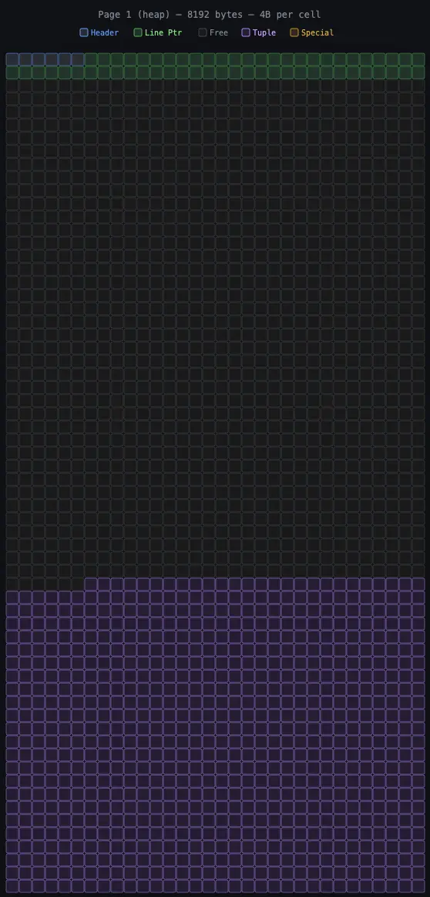

每个单元格占 4 字节，网格的读取顺序为从左到右、从上到下——与十六进制dump的读取方式一致。整个 8192 字节的页面会映射到 2048 个单元格，排列成 32×64 的网格。

---

## 4. 堆页面（表）

选择 actor 表的第 0 页。这是一个存储 actor 行数据的堆页面。

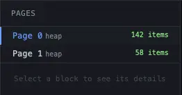

### 4.1 页面头部

点击第一行中任意蓝色单元格。侧边栏的详情面板会显示页面头部的字段：

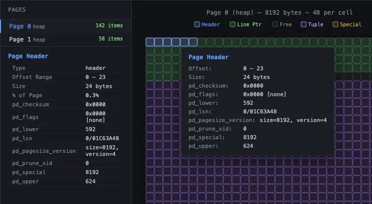

核心字段说明：

| 字段       | 含义                                                                 |
|------------|----------------------------------------------------------------------|
| `pd_lsn`   | 该页面最后一次修改的 WAL 位置。用于崩溃恢复。                         |
| `pd_lower` | 行指针结束的字节偏移量。                                             |
| `pd_upper` | 元组数据开始的字节偏移量。                                           |
| `pd_special` | 特殊空间的起始位置。对于堆页面，该值等于 8192（无特殊区域）。       |

`pd_lower` 和 `pd_upper` 之间的间隙即为空闲空间——对应网格中灰色的单元格。

对应源码：

```c
typedef struct PageHeaderData
{
	/* XXX LSN is member of *any* block, not only page-organized ones */
     * The LSN is used by the buffer manager to enforce the basic rule of WAL:
 	 * "thou shalt write xlog before data".  A dirty buffer cannot be dumped
 	 * to disk until xlog has been flushed at least as far as the page's LSN.
 	 */
	PageXLogRecPtr pd_lsn;		/* LSN: next byte after last byte of xlog
								 * record for last change to this page */
	uint16		pd_checksum;	/* checksum */
	uint16		pd_flags;		/* flag bits, see below */
	LocationIndex pd_lower;		/* offset to start of free space */
	LocationIndex pd_upper;		/* offset to end of free space */
	LocationIndex pd_special;	/* offset to start of special space */
	uint16		pd_pagesize_version;
	TransactionId pd_prune_xid; /* oldest prunable XID, or zero if none */
	ItemIdData	pd_linp[FLEXIBLE_ARRAY_MEMBER]; /* line pointer array */
} PageHeaderData;

typedef PageHeaderData *PageHeader;

/*
 * A line pointer on a buffer page.  See buffer page definitions and comments
 * for an explanation of how line pointers are used.
 */
typedef struct ItemIdData
{
	unsigned	lp_off:15,		/* offset to tuple (from start of page) */
				lp_flags:2,		/* state of line pointer, see below */
				lp_len:15;		/* byte length of tuple */
} ItemIdData;

typedef ItemIdData *ItemId;

/*
 * lp_flags has these possible states.  An UNUSED line pointer is available
 * for immediate re-use, the other states are not.
 */
#define LP_UNUSED		0		/* unused (should always have lp_len=0) */
#define LP_NORMAL		1		/* used (should always have lp_len>0) */
#define LP_REDIRECT		2		/* HOT redirect (should have lp_len=0) */
#define LP_DEAD			3		/* dead, may or may not have storage */
```

相关宏或函数源码：

```c
// src/include/storage/bufpage.h
/*
 * PageIsEmpty
 *		returns true iff no itemid has been allocated on the page
 */
static inline bool
PageIsEmpty(Page page)
{
	return ((PageHeader) page)->pd_lower <= SizeOfPageHeaderData;
}

/*
 * PageGetItemId
 *		Returns an item identifier of a page.
 */
static inline ItemId
PageGetItemId(Page page, OffsetNumber offsetNumber)
{
	return &((PageHeader) page)->pd_linp[offsetNumber - 1];
}

/*
 * PageGetPageSize
 *		Returns the page size of a page.
 *
 * this can only be called on a formatted page (unlike
 * BufferGetPageSize, which can be called on an unformatted page).
 * however, it can be called on a page that is not stored in a buffer.
 */
static inline Size
PageGetPageSize(Page page)
{
	return (Size) (((PageHeader) page)->pd_pagesize_version & (uint16) 0xFF00);
}

// src/include/storage/itemid.h
/*
 *		ItemIdGetLength
 */
#define ItemIdGetLength(itemId) \
   ((itemId)->lp_len)


/*
 *		ItemIdGetOffset
 */
#define ItemIdGetOffset(itemId) \
   ((itemId)->lp_off)

/*
 *		ItemIdGetFlags
 */
#define ItemIdGetFlags(itemId) \
   ((itemId)->lp_flags)

/*
 * ItemIdIsNormal
 *		True iff item identifier is in state NORMAL.
 */
#define ItemIdIsNormal(itemId) \
	((itemId)->lp_flags == LP_NORMAL)

```

### 4.2 行指针与元组

将鼠标悬停在绿色单元格（行指针）上。你会发现对应的紫色单元格（该指针指向的元组）会同时高亮。这种交叉高亮展示了行指针与其指向的元组之间的关联。

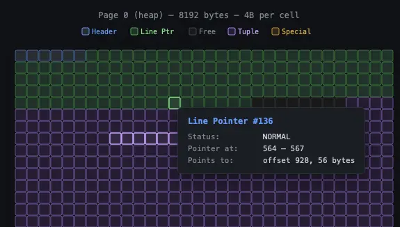

点击右侧「项目（items）」面板中的某个元组，查看其详情：

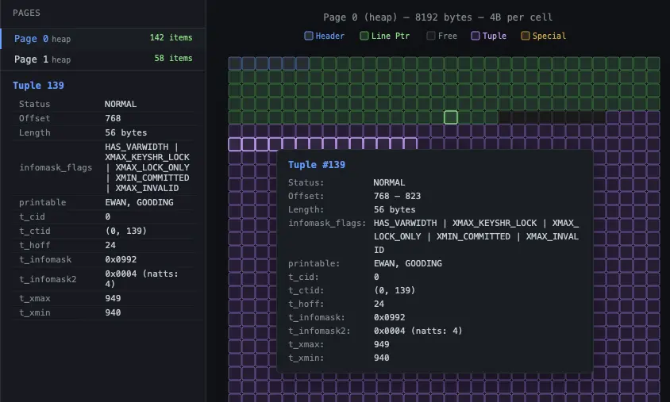

每个堆元组都有一个包含 MVCC 元数据的头部：

| 字段         | 含义                                                                 |
|--------------|----------------------------------------------------------------------|
| `t_xmin`     | 插入该行的事务 ID。                                                 |
| `t_xmax`     | 删除或锁定该行的事务 ID。                                           |
| `t_ctid`     | 物理位置（页面，行指针）。对于活跃元组，指向自身；对于更新后的元组，指向更新链中的下一个版本。 |
| `t_infomask` | 可见性标志：`XMIN_COMMITTED`、`XMAX_INVALID`、`HOT_UPDATED` 等。     |
| `t_hoff`     | 元组内用户数据开始的偏移量。                                         |

对应源码：

```c
// src/include/access/htup_details.h
struct HeapTupleHeaderData
{
	union
	{
		HeapTupleFields t_heap;
		DatumTupleFields t_datum;
	}			t_choice;

	ItemPointerData t_ctid;		/* current TID of this or newer tuple (or a
								 * speculative insertion token) */

	/* Fields below here must match MinimalTupleData! */

#define FIELDNO_HEAPTUPLEHEADERDATA_INFOMASK2 2
	uint16		t_infomask2;	/* number of attributes + various flags */

#define FIELDNO_HEAPTUPLEHEADERDATA_INFOMASK 3
	uint16		t_infomask;		/* various flag bits, see below */

#define FIELDNO_HEAPTUPLEHEADERDATA_HOFF 4
	uint8		t_hoff;			/* sizeof header incl. bitmap, padding */

	/* ^ - 23 bytes - ^ */

#define FIELDNO_HEAPTUPLEHEADERDATA_BITS 5
	bits8		t_bits[FLEXIBLE_ARRAY_MEMBER];	/* bitmap of NULLs */

	/* MORE DATA FOLLOWS AT END OF STRUCT */
};

typedef struct HeapTupleFields
{
	TransactionId t_xmin;		/* inserting xact ID */
	TransactionId t_xmax;		/* deleting or locking xact ID */

	union
	{
		CommandId	t_cid;		/* inserting or deleting command ID, or both */
		TransactionId t_xvac;	/* old-style VACUUM FULL xact ID */
	}			t_field3;
} HeapTupleFields;
```

Tuple头部信息解释，MVCC 信息：

```c
uint16		t_infomask;		/* various flag bits, see below */

/*
 * information stored in t_infomask:
 */
#define HEAP_HASNULL			0x0001	/* has null attribute(s) */
#define HEAP_HASVARWIDTH		0x0002	/* has variable-width attribute(s) */
#define HEAP_HASEXTERNAL		0x0004	/* has external stored attribute(s) */
#define HEAP_HASOID_OLD			0x0008	/* has an object-id field */
#define HEAP_XMAX_KEYSHR_LOCK	0x0010	/* xmax is a key-shared locker */
#define HEAP_COMBOCID			0x0020	/* t_cid is a combo CID */
#define HEAP_XMAX_EXCL_LOCK		0x0040	/* xmax is exclusive locker */
#define HEAP_XMAX_LOCK_ONLY		0x0080	/* xmax, if valid, is only a locker */

 /* xmax is a shared locker */
#define HEAP_XMAX_SHR_LOCK	(HEAP_XMAX_EXCL_LOCK | HEAP_XMAX_KEYSHR_LOCK)

#define HEAP_LOCK_MASK	(HEAP_XMAX_SHR_LOCK | HEAP_XMAX_EXCL_LOCK | \
						 HEAP_XMAX_KEYSHR_LOCK)
#define HEAP_XMIN_COMMITTED		0x0100	/* t_xmin committed */
#define HEAP_XMIN_INVALID		0x0200	/* t_xmin invalid/aborted */
#define HEAP_XMIN_FROZEN		(HEAP_XMIN_COMMITTED|HEAP_XMIN_INVALID)
#define HEAP_XMAX_COMMITTED		0x0400	/* t_xmax committed */
#define HEAP_XMAX_INVALID		0x0800	/* t_xmax invalid/aborted */

#define HEAP_XMAX_IS_MULTI		0x1000	/* t_xmax is a MultiXactId */
#define HEAP_UPDATED			0x2000	/* this is UPDATEd version of row */
#define HEAP_MOVED_OFF			0x4000	/* moved to another place by pre-9.0
										 * VACUUM FULL; kept for binary
										 * upgrade support */
#define HEAP_MOVED_IN			0x8000	/* moved from another place by pre-9.0
										 * VACUUM FULL; kept for binary
										 * upgrade support */

-----------

uint16		t_infomask2;	/* number of attributes + various flags */
/*
 * information stored in t_infomask2:
 */
#define HEAP_NATTS_MASK			0x07FF	/* 11 bits for number of attributes */
/* bits 0x1800 are available */
#define HEAP_KEYS_UPDATED		0x2000	/* tuple was updated and key cols
										 * modified, or tuple deleted */
#define HEAP_HOT_UPDATED		0x4000	/* tuple was HOT-updated */
#define HEAP_ONLY_TUPLE			0x8000	/* this is heap-only tuple */

#define HEAP2_XACT_MASK			0xE000	/* visibility-related bits */

// 操作宏
#define HeapTupleHeaderGetRawXmin(tup) \
( \
	(tup)->t_choice.t_heap.t_xmin \
)

#define HeapTupleHeaderGetXmin(tup) \
( \
	HeapTupleHeaderXminFrozen(tup) ? \
		FrozenTransactionId : HeapTupleHeaderGetRawXmin(tup) \
)

#define HeapTupleHeaderSetXmin(tup, xid) \
( \
	(tup)->t_choice.t_heap.t_xmin = (xid) \
)

#define HeapTupleHeaderXminCommitted(tup) \
( \
	((tup)->t_infomask & HEAP_XMIN_COMMITTED) != 0 \
)

#define HeapTupleHeaderXminInvalid(tup) \
( \
	((tup)->t_infomask & (HEAP_XMIN_COMMITTED|HEAP_XMIN_INVALID)) == \
		HEAP_XMIN_INVALID \
)
```

### 4.3 页面填充度

观察网格中灰色（空闲空间）的占比。actor 表的第 0 页几乎被占满——页面大部分区域是紫色（元组）和绿色（行指针），仅在两者之间有一小条灰色空闲空间。

现在点击侧边栏中的第 1 页。该页面的元组更少、空闲空间更多——你可以从网格中直接看出这种差异。

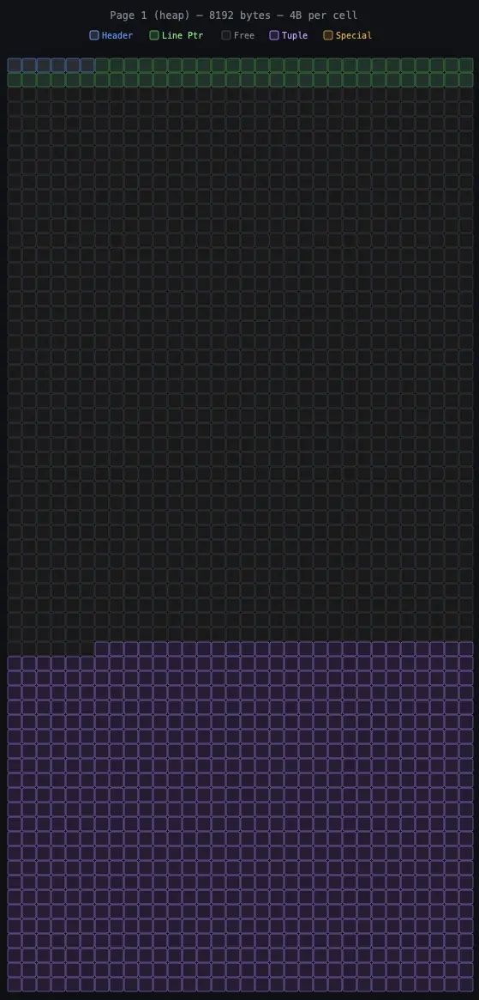

---

## 5. B 树索引页面

打开 `actor_pkey` 文件（基于 `actor_id` 的 B 树主键索引）。

### 5.1 元页面（第 0 页）

每个 B 树都以一个元页面开头。选择第 0 页，网格标题会显示「B-tree / meta」以标识该页面子类型。

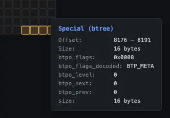

头部之后的金色单元格是 `BTMetaPageData` 结构体。将鼠标悬停在单个单元格上，可查看每个字段的名称和解析后的值。右侧的项目面板会列出所有元字段：

- `btm_magic`：应为 `0x00053162`。
- `btm_root`：树的根页面编号。
- `btm_level`：树的层级数。由于只有 200 个 actor 记录，该树仅需一层（根节点 = 叶子节点）。
- `btm_allequalimage`：索引是否支持去重。

底部的橙色单元格是特殊区域（`BTPageOpaqueData`），其中设置了 `BTP_META` 标志。

### 5.2 叶子页面

选择第 1 页（根/叶子页面），将其与堆页面对比：

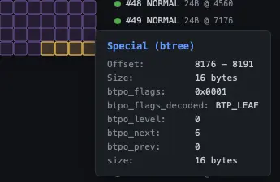

核心差异：

- **底部的橙色单元格**：16 字节的特殊区域包含 `BTPageOpaqueData`——兄弟指针（`btpo_prev`、`btpo_next`）、树层级，以及 `BTP_LEAF`、`BTP_ROOT` 等标志。
- **更小的元组**：索引元组远小于堆元组。每个索引元组仅包含被索引的键（`actor_id`）和指向堆的 TID。
- **更多空闲空间**：由于索引条目更紧凑，紫色区域（元组）占页面大小的比例更小。

点击某个索引元组查看详情：

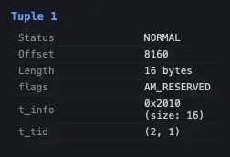

`t_tid` 字段（例如 `(0, 1)`）是指向堆的指针——对应 actor 表中「第 0 页，第 1 个行指针」的位置。

### 5.3 内部页面

对于更大的索引（如 `rental_pkey`），树会有多个层级。内部页面的每个元组会显示 `child_block`（子块）而非 `t_tid`——这是指向树中子页面的下行链接，而非指向堆的指针。

---

源码：

```c
typedef struct PageHeaderData
{
    PageXLogRecPtr pd_lsn;
    uint16  pd_checksum;
    uint16  pd_flags;
    LocationIndex pd_lower;
    LocationIndex pd_upper;
    LocationIndex pd_special;
    uint16  pd_pagesize_version;
    TransactionId pd_prune_xid;
    ItemIdData pd_linp[FLEXIBLE_ARRAY_MEMBER];
} PageHeaderData;

// src/include/access/nbtree.h
/*
 * The Meta page is always the first page in the btree index.
 * Its primary purpose is to point to the location of the btree root page.
 * We also point to the "fast" root, which is the current effective root;
 * see README for discussion.
 */
// 该数据结构只在 Meta页面存在，紧跟在 PageHeader 之后
typedef struct BTMetaPageData
{
	uint32		btm_magic;		/* should contain BTREE_MAGIC */
	uint32		btm_version;	/* nbtree version (always <= BTREE_VERSION) */
	BlockNumber btm_root;		/* current root location */
	uint32		btm_level;		/* tree level of the root page */
	BlockNumber btm_fastroot;	/* current "fast" root location */
	uint32		btm_fastlevel;	/* tree level of the "fast" root page */
	/* remaining fields only valid when btm_version >= BTREE_NOVAC_VERSION */

	/* number of deleted, non-recyclable pages during last cleanup */
	uint32		btm_last_cleanup_num_delpages;
	/* number of heap tuples during last cleanup (deprecated) */
	float8		btm_last_cleanup_num_heap_tuples;

	bool		btm_allequalimage;	/* are all columns "equalimage"? */
} BTMetaPageData;

// 索引特殊空间定义
typedef struct BTPageOpaqueData
{
	BlockNumber btpo_prev;		/* left sibling, or P_NONE if leftmost */
	BlockNumber btpo_next;		/* right sibling, or P_NONE if rightmost */
	uint32		btpo_level;		/* tree level --- zero for leaf pages */
	uint16		btpo_flags;		/* flag bits, see below */   // << 重要，区分页面类型标记
	BTCycleId	btpo_cycleid;	/* vacuum cycle ID of latest split */
} BTPageOpaqueData;

typedef BTPageOpaqueData *BTPageOpaque;

#define BTPageGetOpaque(page) ((BTPageOpaque) PageGetSpecialPointer(page))

/* Bits defined in btpo_flags */
#define BTP_LEAF		(1 << 0)	/* leaf page, i.e. not internal page */
#define BTP_ROOT		(1 << 1)	/* root page (has no parent) */
#define BTP_DELETED		(1 << 2)	/* page has been deleted from tree */
#define BTP_META		(1 << 3)	/* meta-page */
#define BTP_HALF_DEAD	(1 << 4)	/* empty, but still in tree */
#define BTP_SPLIT_END	(1 << 5)	/* rightmost page of split group */
#define BTP_HAS_GARBAGE (1 << 6)	/* page has LP_DEAD tuples (deprecated) */
#define BTP_INCOMPLETE_SPLIT (1 << 7)	/* right sibling's downlink is missing */
#define BTP_HAS_FULLXID	(1 << 8)	/* contains BTDeletedPageData */
```

检查宏：

```c
// src/include/access/nbtree.h
#define P_ISLEAF(opaque)		(((opaque)->btpo_flags & BTP_LEAF) != 0)
#define P_ISROOT(opaque)		(((opaque)->btpo_flags & BTP_ROOT) != 0)
#define P_ISDELETED(opaque)		(((opaque)->btpo_flags & BTP_DELETED) != 0)
#define P_ISMETA(opaque)		(((opaque)->btpo_flags & BTP_META) != 0)
```

### 5.4 如何构成树状结构

- 原理解释

```CQL
// 内部节点Page 每个索引元组会记录向下的 块号，用一个 32 位整数表示。存储结构如下
typedef struct BlockIdData
{
	uint16		bi_hi;
	uint16		bi_lo;
} BlockIdData;

typedef uint32 BlockNumber;

/*
 * BlockIdGetBlockNumber
 *		Retrieve the block number from a block identifier.
 */
static inline BlockNumber
BlockIdGetBlockNumber(const BlockIdData *blockId)
{
	return (((BlockNumber) blockId->bi_hi) << 16) | ((BlockNumber) blockId->bi_lo);
}

/*
 * BlockIdSet
 *		Sets a block identifier to the specified value.
 */
// 把一个 32 位整数拆成两个 16 位整数保存起来
static inline void
BlockIdSet(BlockIdData *blockId, BlockNumber blockNumber)
{
	blockId->bi_hi = blockNumber >> 16;
	blockId->bi_lo = blockNumber & 0xffff;
}
```

**rental_pkey B-tree 索引文件 Page列表：**

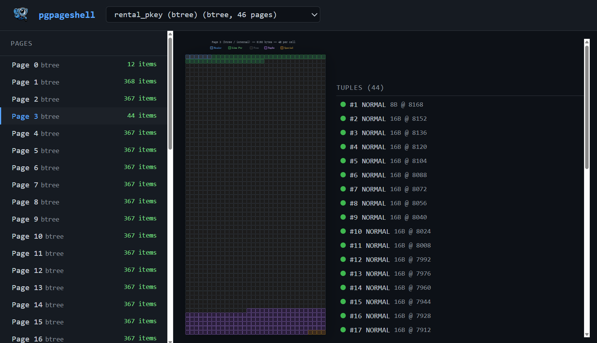

**rental_pkey B-tree 索引树状结构：**

- 从 Meta Page 获取B-Tree 根节点，B-Tree 高度
- 从 根节点逐个找子节点，递归画出整个树

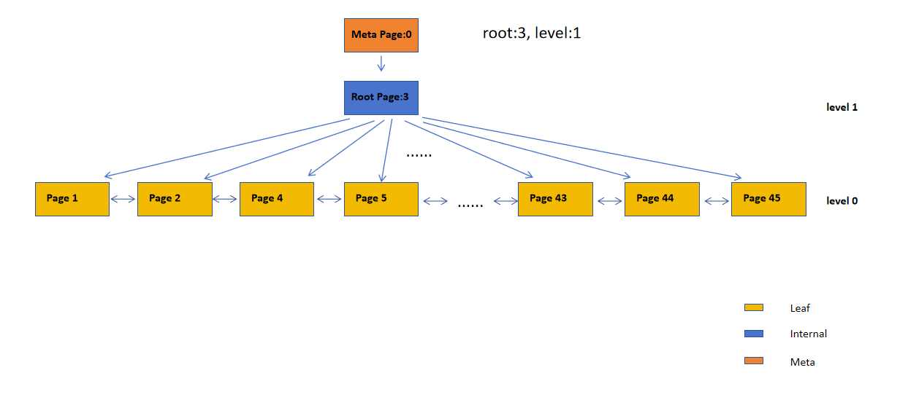


---

## 6. 哈希索引页面

哈希索引文件基本知识参见:  [PG哈希索引页面类型知识.md](./PG哈希索引页面类型知识.md)

### 整体布局

假设一个 Hash 索引文件：

```
Block 0     Meta Page

Block 1     Bucket 0
Block 2     Bucket 1
Block 3     Bucket 2
Block 4     Bucket 3

Block 5     Bitmap Page

Block 100   Overflow Page
Block 101   Overflow Page
```

逻辑结构：

```
Hash Index

├── Meta Page
├── Bucket Pages
├── Overflow Pages
├── Bitmap Pages
└── Unused Pages
```

打开 `idx_hash_customer_email` 文件。

### 6.1 元页面

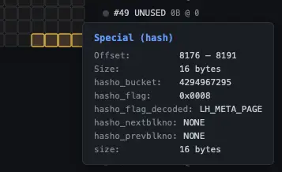

哈希索引的元页面较大——`HashMetaPageData` 结构体占据了页面的大部分空间。将鼠标悬停在金色单元格上，查看各个字段：

- `hashm_magic`：应为 `0x06440640`。
- `hashm_ntuples`：索引元组的总数（599 个客户邮箱）。
- `hashm_ffactor`：每个桶的目标元组数量。
- `hashm_maxbucket`：最大的桶编号。
- `hashm_spares[32]`：跟踪溢出页面分配的数组。
- `hashm_mapp[...]`：位图页面块编号的数组。

### 6.2 桶页面

导航到桶页面（在网格标题中查找子类型为「bucket」的页面）。

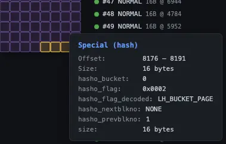

哈希页面的特殊区域标志中包含四种子类型：`LH_META_PAGE`、`LH_BUCKET_PAGE`、`LH_OVERFLOW_PAGE` 和 `LH_BITMAP_PAGE`。`hasho_page_id` 中的魔术数 `0xFF80` 用于标识哈希页面。

### 6.3 位图页面

找到位图页面（通常是第 3 页）。网格中显示的青色单元格——每个 4 字节的单元格是一个 uint32 整数，用于跟踪 32 个溢出页面。将鼠标悬停可查看十六进制值和已置位的位数（例如 `0xFFFFFFFF (32/32 bits set)`）。

对应源码：

```c
/*
 * In an overflow page, hasho_prevblkno stores the block number of the previous
 * page in the bucket chain; in a bucket page, hasho_prevblkno stores the
 * hashm_maxbucket value as of the last time the bucket was last split, or
 * else as of the time the bucket was created.  The latter convention is used
 * to determine whether a cached copy of the metapage is too stale to be used
 * without needing to lock or pin the metapage.
 *
 * hasho_nextblkno is always the block number of the next page in the
 * bucket chain, or InvalidBlockNumber if there are no more such pages.
 */
typedef struct HashPageOpaqueData
{
	BlockNumber hasho_prevblkno;	/* see above */
	BlockNumber hasho_nextblkno;	/* see above */
	Bucket		hasho_bucket;	/* bucket number this pg belongs to */
	uint16		hasho_flag;		/* page type code + flag bits, see above */
	uint16		hasho_page_id;	/* for identification of hash indexes */
} HashPageOpaqueData;

typedef struct HashMetaPageData
{
	uint32		hashm_magic;	/* magic no. for hash tables */
	uint32		hashm_version;	/* version ID */
	double		hashm_ntuples;	/* number of tuples stored in the table */
	uint16		hashm_ffactor;	/* target fill factor (tuples/bucket) */
	uint16		hashm_bsize;	/* index page size (bytes) */
	uint16		hashm_bmsize;	/* bitmap array size (bytes) - must be a power
								 * of 2 */
	uint16		hashm_bmshift;	/* log2(bitmap array size in BITS) */
	uint32		hashm_maxbucket;	/* ID of maximum bucket in use */
	uint32		hashm_highmask; /* mask to modulo into entire table */
	uint32		hashm_lowmask;	/* mask to modulo into lower half of table */
	uint32		hashm_ovflpoint;	/* splitpoint from which ovflpage being
									 * allocated */
	uint32		hashm_firstfree;	/* lowest-number free ovflpage (bit#) */
	uint32		hashm_nmaps;	/* number of bitmap pages */
	RegProcedure hashm_procid;	/* hash function id from pg_proc */
	uint32		hashm_spares[HASH_MAX_SPLITPOINTS]; /* spare pages before each
													 * splitpoint */
	BlockNumber hashm_mapp[HASH_MAX_BITMAPS];	/* blknos of ovfl bitmaps */
} HashMetaPageData;
```


---

## 7. GIN 索引页面

GIN（Generalized Inverted Index）倒排索引。当一个字段包含多个"可搜索元素（keys）"，而查询条件是"这个字段是否包含某个元素"时，GIN 通常是最合适的索引。

打开 `idx_gin_film_fulltext` 文件。

### 7.1 元页面

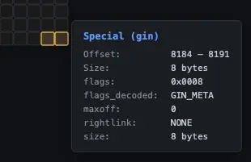

GIN 元页面的金色单元格会显示每个字段的详情。将鼠标悬停在单元格上，查看 `GinMetaPageData` 字段：

| 字段            | 含义                                                         |
| --------------- | ------------------------------------------------------------ |
| `head` / `tail` | 待处理列表（pending list）的边界（若为空则为 `0xFFFFFFFF`）。 |
| `nEntries`      | Number of distinct lexemes indexed.                          |
| `nEntryPages`   | Pages in the entry tree (B-tree of keys).                    |
| `nDataPages`    | Pages for posting trees (0 if all posting lists fit inline). |
| `nPendingPages` | Fast-inserted entries waiting to be merged.                  |
| `ginVersion`    | GIN format version.                                          |

对应源码：

```c
typedef struct GinMetaPageData
{
	/*
	 * Pointers to head and tail of pending list, which consists of GIN_LIST
	 * pages.  These store fast-inserted entries that haven't yet been moved
	 * into the regular GIN structure.
	 */
	BlockNumber head;
	BlockNumber tail;

	/*
	 * Free space in bytes in the pending list's tail page.
	 */
	uint32		tailFreeSize;

	/*
	 * We store both number of pages and number of heap tuples that are in the
	 * pending list.
	 */
	BlockNumber nPendingPages;
	int64		nPendingHeapTuples;

	/*
	 * Statistics for planner use (accurate as of last VACUUM)
	 */
	BlockNumber nTotalPages;
	BlockNumber nEntryPages;
	BlockNumber nDataPages;
	int64		nEntries;

	/*
	 * GIN version number (ideally this should have been at the front, but too
	 * late now.  Don't move it!)
	 *
	 * Currently 2 (for indexes initialized in 9.4 or later)
	 *
	 * Version 1 (indexes initialized in version 9.1, 9.2 or 9.3), is
	 * compatible, but may contain uncompressed posting tree (leaf) pages and
	 * posting lists. They will be converted to compressed format when
	 * modified.
	 *
	 * Version 0 (indexes initialized in 9.0 or before) is compatible but may
	 * be missing null entries, including both null keys and placeholders.
	 * Reject full-index-scan attempts on such indexes.
	 */
	int32		ginVersion;
} GinMetaPageData;
```

### 7.2 条目页面

导航到条目页面。GIN 采用两级结构：

1. **条目树（entry tree）** —  a B-tree of keys (lexemes).。
2. 对于每个键，有一个 **投递列表（posting list）** 或 **投递树（posting tree）**，存储堆 TID。

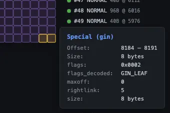

特殊区域中的 `GIN_LEAF`、`GIN_DATA` 和 `GIN_COMPRESSED` 标志可标识当前 GIN 页面的类型。

源码定义：

```c
/*
 * Page opaque data in an inverted index page.
 *
 * Note: GIN does not include a page ID word as do the other index types.
 * This is OK because the opaque data is only 8 bytes and so can be reliably
 * distinguished by size.  Revisit this if the size ever increases.
 * Further note: as of 9.2, SP-GiST also uses 8-byte special space, as does
 * BRIN as of 9.5.  This is still OK, as long as GIN isn't using all of the
 * high-order bits in its flags word, because that way the flags word cannot
 * match the page IDs used by SP-GiST and BRIN.
 */
typedef struct GinPageOpaqueData
{
	BlockNumber rightlink;		/* next page if any */
	OffsetNumber maxoff;		/* number of PostingItems on GIN_DATA &
								 * ~GIN_LEAF page. On GIN_LIST page, number of
								 * heap tuples. */
	uint16		flags;			/* see bit definitions below */
} GinPageOpaqueData;

typedef GinPageOpaqueData *GinPageOpaque;

#define GIN_DATA		  (1 << 0)  // 存 小 posting list（inline）或者 GIN_DATA page = posting tree node
#define GIN_LEAF		  (1 << 1)  // Key B-tree 的叶子节点
#define GIN_DELETED		  (1 << 2)
#define GIN_META		  (1 << 3)
#define GIN_LIST		  (1 << 4)  // 未合并插入
#define GIN_LIST_FULLROW  (1 << 5)	/* makes sense only on GIN_LIST page */
#define GIN_INCOMPLETE_SPLIT (1 << 6)	/* page was split, but parent not
										 * updated */
#define GIN_COMPRESSED	  (1 << 7)
```

---

## 8. BRIN 索引页面

在 PostgreSQL 中，BRIN（Block Range INdex）通常直接被称为**块范围索引** 或**块级索引**。它是一种专门为处理超大表而设计的轻量级索引类型。 [[1](https://zhmin.github.io/posts/postgresql-block-range-index/), [2](https://blog.csdn.net/weixin_39540651/article/details/103770484), [3](https://developer.aliyun.com/article/1636329)]

核心特性概览

- **名称来源**：全称为 **Block Range Indexes**。
- **索引原理**：它不记录单行数据的具体位置，而是记录相邻物理数据块（Block Range）内的**元数据**（如最大值/最小值、Null值存在情况等）。

---

打开 `idx_brin_rental_id` 文件。BRIN 是空间效率最高的索引类型——它不会为单行建立索引，而是为连续的堆页面范围存储汇总信息。

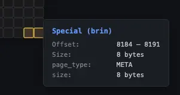

元页面的金色单元格显示各字段详情：

| 字段             | 含义                                                                 |
|------------------|----------------------------------------------------------------------|
| `brinMagic`      | 应为 `0xA8109CFA`。                                                  |
| `pagesPerRange`  | 每个 BRIN 条目覆盖的堆页面数（默认：128）。                          |
| `lastRevmapPage` | 最后一个范围映射页面的位置。                                         |

BRIN 包含三种页面类型：

- **元页面（第 0 页）**：配置信息——金色单元格存储结构体字段。
- **范围映射页面（Revmap，第 1 页）**：将块范围编号映射到汇总元组——紫罗兰色单元格。将鼠标悬停在每个 6 字节的条目上，可查看其目标位置 `(block, offset)`，未汇总的范围则显示 `(invalid)`。
- **常规页面**：存储实际的汇总元组（最小值/最大值）。

对应源码：

```c
/* Metapage definitions */
typedef struct BrinMetaPageData
{
	uint32		brinMagic;
	uint32		brinVersion;
	BlockNumber pagesPerRange;
	BlockNumber lastRevmapPage;
} BrinMetaPageData;
```

### 8.1 范围映射页面

选择第 1 页，网格中会充满紫罗兰色单元格——这是范围映射数组。每个条目是一个 `ItemPointerData`（6 字节），将一个堆页面范围映射到对应的 BRIN 汇总元组。将鼠标悬停可查看每个范围指向的位置。


当 `pagesPerRange = 128` 时，每个 BRIN 条目约覆盖 1MB 的表数据。rental 表的整个 BRIN 索引仅需 3 个页面（24KB）——对比同一列上的 B 树索引（需要几十个页面），差异显著。

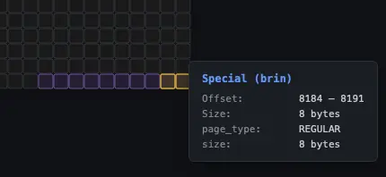

---

## 9. 练习

尝试完成以下练习，加深理解：

1. **更新并检查**：执行 `UPDATE actor SET first_name = 'UPDATED' WHERE actor_id = 1;`，然后执行 `CHECKPOINT;`。重新打开 actor 表文件，查看第 0 页。找到带有 `HOT_UPDATED` 标志的旧元组，以及带有 `HEAP_ONLY` 标志的新元组。注意旧元组的 `t_ctid` 指向新元组。
2. **对比索引大小**：打开每个索引文件，统计侧边栏中的页面数。对比 `rental_id` 上的 BRIN 索引（3 页）和同一列上的 B 树索引。为什么 BRIN 索引的体积小这么多？
3. **执行 VACUUM 后检查**：执行 `VACUUM actor;`，然后执行 `CHECKPOINT;`。重新打开 actor 表文件，在元组详情中查找 `XMIN_FROZEN` 标志，以及行指针的 `REDIRECT`/`UNUSED` 状态。
4. **删除并观察死元组**：删除若干行，执行 `CHECKPOINT;` 后重新检查。找到状态为 `DEAD` 的行指针。然后执行 `VACUUM`，再次执行 checkpoint，观察这些指针变为 `UNUSED`。
5. **填满页面**：向一个小表中插入足够多的行，将页面完全填满（网格中无灰色单元格）。再插入一行，观察 PostgreSQL 分配新页面

```sql
CREATE TABLE pgpageshell_t (
    id   integer,
    name varchar,
    age  integer
);

INSERT INTO pgpageshell_t (id, name, age)
SELECT
    i,
    'name_' || i,
    (i % 100)
FROM generate_series(1, 1000) AS i;
```
Page 快满时：

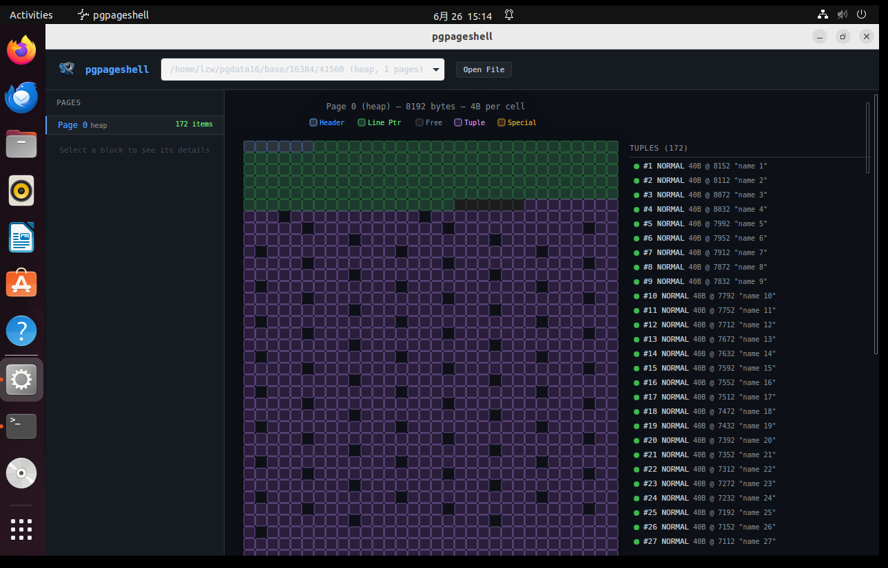

快满之后继续插入分配了另一个Page:

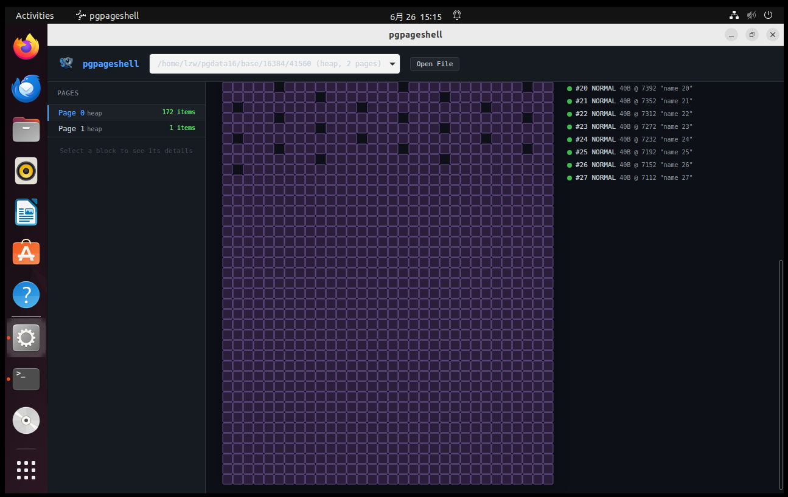


## 10. 以前培训内容

`\\192.168.4.11\文件共享\内部培训材料\内核技术\2025数据库内核专项提升培训\第3课-pg物理文件格式解析\工具` 下 `chap` 工具。类似一个 16 进制 dump 工具，可以用16进制的方式查看数据文件，可以跳转到数据文件任意偏移量，解码数据文件内容。

## 11. 有用 SQL 总结

```sql
CREATE TABLE pgpageshell_t (
    id   integer,
    name varchar,
    age  integer
);

INSERT INTO pgpageshell_t (id, name, age)
SELECT
    i,
    'name_' || i,
    (i % 100)
FROM generate_series(1, 1000) AS i;

select pg_relation_filepath('pgpageshell_t4');

vacuum pgpageshell_t3;

delete from pgpageshell_t3 where id = 9 ;

UPDATE pgpageshell_t3 SET name = 'tianpenyuanshuai' WHERE id = 6;
```

